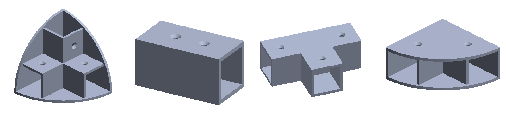

# Connector Kit

Parametric, 3D-printable connectors for square stock, such as wooden battens, built with
[Cadova](https://github.com/tomasf/Cadova). Every dimension follows from a few reusable sizing
rules, so the same code makes a corner for 22 mm battens or a tee for 30 mm tubes.



**[Open the customizer](https://loeti.github.io/connector-kit/)** to set the parameters, preview
the connector in 3D and download a 3MF file for your slicer. It runs entirely in your browser.

## Connectors

A connector has a socket (arm) along any of the six axis directions. Turning arms on and off
covers the common shapes:

| Shape | Arms | Options |
|---|---|---|
| Three-way corner | +X, +Y, +Z | gussets on the back faces |
| Elbow | +X, +Y | gussets on one or both faces |
| Tee | +X, −X, +Y | optionally pass-through along X |
| Straight coupler | −Y, +Y | stop lip in the middle, or pass-through for a plain sleeve |
| Cross, five- and six-way | any | |

### Parameters

| Parameter | Default | Description |
|---|---|---|
| Stock size | 22 mm | Width of the square stock |
| Clearance | 0.2 mm | Total play between stock and socket (both sides combined); also added to the screw holes |
| Socket depth | 25 mm | How far the stock goes into each socket |
| Wall sizing | Outer size | Size the sockets by their outer size or by their wall thickness |
| Outer size / Wall thickness | 27 mm / 2.4 mm | The value for the chosen wall sizing |
| Minimum wall thickness | 1.2 mm | The wall is never thinner than this |
| Arm towards ±X/±Y/±Z | +X, +Y, +Z | Which arms the connector has |
| Pass-through | None | Axis along which the stock runs straight through |
| Gussets | On | Quarter-disc plates between perpendicular arms |
| Gusset overhang | 8 mm | How far the gussets reach beyond the socket ends |
| Gusset sides | Automatic | One gusset per pair of arms, or both faces joined by edge walls |
| Screws | M3 | Countersunk screw (M2–M6) or none |
| Screws per arm | 1 | One or two screws per socket |
| Show stock | Off | Shows the inserted stock as reference; it isn't printed |

## Sizing rules

The rules live in the `ConnectorKit` library and can be used for other parts too.

- **Wall thickness.** A socket is either sized by its outer size,
  `wall = (outer − stock − clearance) / 2`, or by a fixed wall thickness. Either way the wall is
  never thinner than the minimum; if the target would need a thinner wall, the socket grows.
  For 22 mm stock in a 27 mm socket: 2.4 + 0.1 + 22 + 0.1 + 2.4 = 27.
- **Clearance.** The clearance is Cadova's `tolerance`: the total play of a fit, both sides
  combined.
- **Countersinks.** A screw head is only countersunk if the wall is at least as thick as the
  head is tall; otherwise the hole is a plain through hole.
- **Screw placement.** Screws go on the first free face in the order top, back, right, front,
  left, bottom. A face split by a centered gusset isn't free. A second screw goes on the
  opposite face, and screws are spread evenly along the socket so they don't meet.
- **Gussets.** Gussets are as thick as the socket wall and sit flush with a hub face: opposite
  the arm on the third axis, at the bottom if there is none, or centered if there are arms in
  both directions.
- **Hub.** The hub is a cube as wide as a socket and stops the stock. If all arms lie on one
  axis, the hub shrinks to a thin stop lip, or disappears if the stock passes through.

## Using the library

Add the package to your own Cadova project:

```swift
.package(url: "https://github.com/loeti/connector-kit.git", branch: "main")
```

and build a connector from a configuration:

```swift
import Cadova
import ConnectorKit

let corner = ConnectorConfiguration(
    socket: SocketSpec(stock: Stock(size: 22), wallRule: WallRule(.outerSize(27))),
    socketDepth: 25,
    arms: [Arm(.maxX), Arm(.maxY), Arm(.maxZ)],
    screw: .countersunk(.m3),
    gussets: .quarterDisc(overhang: 8, sides: .automatic)
)

await Model("Corner") {
    Connector(corner)
        .withTolerance(0.2)
}
```

The building blocks (`Hub`, `Socket`, `ScrewHole`, `Gusset`, `GussetEdgeWall`) are public as
well, for parts that aren't connectors.

## Building

Requires Swift 6.3 and macOS 15 or later.

```sh
swift run Connectors    # writes Models/Connector.3mf with the default parameters
swift test              # checks the sizing rules, dimensions, volumes and fit
```

Open the 3MF file in [Cadova Viewer](https://github.com/tomasf/CadovaViewer), which reloads it
whenever it's rebuilt, or in any slicer.

The customizer is published on GitHub Pages by the `Customizer` workflow on every push to
`main`. To build it locally, install the Swift 6.4.0 toolchain from swift.org
(`swiftly install 6.4.0`) and run:

```sh
swift package generate-customizer --product Connectors
python3 -m http.server --directory Customizer 8000
```

## Reference designs

`Models/` contains the original STEP files this kit was derived from. Apart from the ridge joint,
each one is a combination of parameters:

| File | Arms | Other parameters |
|---|---|---|
| `Verbinder 1-1.step` | −Y, +Y | Gussets off, 2 screws per arm |
| `Verbinder 1-2.step` | −X, +X, −Y | Gussets off, pass-through X |
| `Verbinder 2x2.step` | +X, +Y | Gusset sides: both |
| `Verbinder 2x2x2xGelenk.step`, `Adapter Gelenk 22.step` | | Ridge joint, not implemented yet |

The defaults reproduce the three-way corner, which has no STEP file of its own: arms +X, +Y, +Z
with gussets. In the original designs the screw holes sit slightly off-center and are 3.4 mm;
here they are centered and sized from the screw standard plus the clearance.

## License

[MIT](LICENSE)
